  

  

## Projects

| Project | What it is |
| --- | --- |
| [minishell](https://github.com/Kai-Doh/minishell) | A small shell written in C (42) |
| [inception](https://github.com/Kai-Doh/inception) | Docker infrastructure (42) |
